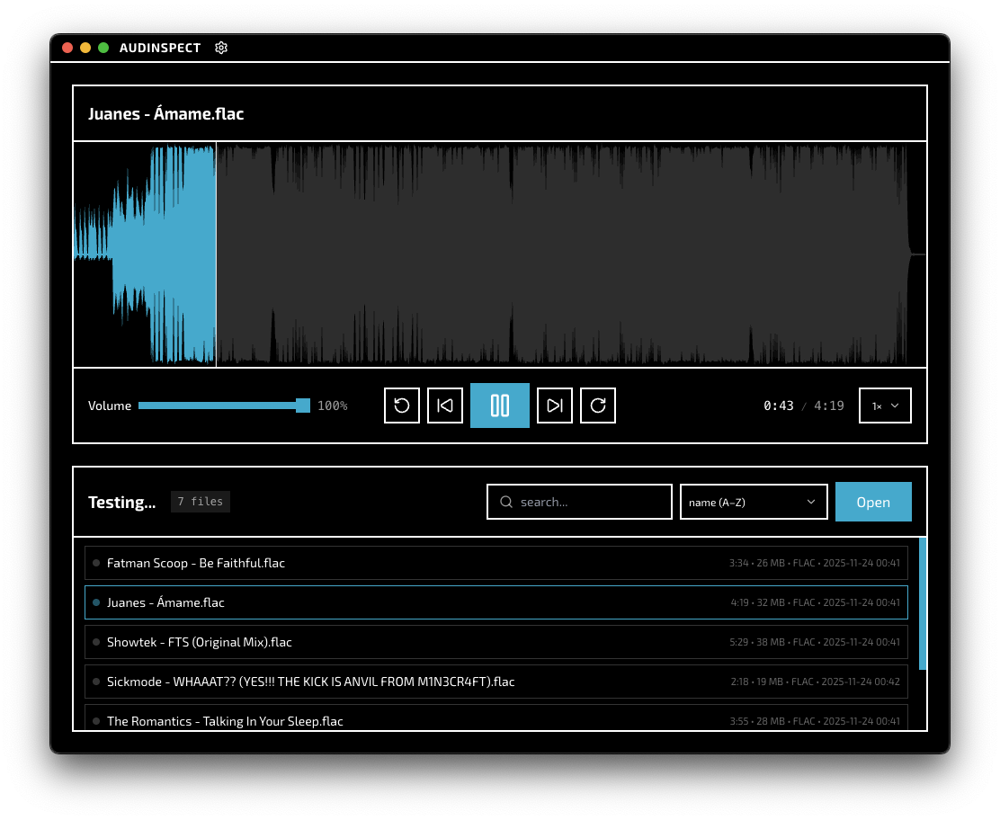

# Audinspect

An audio inspector. Made for quick viewing of audio files. Built with Electron + React and wavesurfer.js



## Features

- Audio scrubbing
- Waveform view
- Quick audio file viewing
- Drag and drop
- Sorting
- Searching
- Metadata viewing
- Volume control
- Speed control
- Interface customization (including waveform, accent color, etc)
- Opens audio files straight from Finder / Explorer / the file manager (file associations, `open with`, command line)

## Who is this for?

This is for music producers, A&R Teams, labels, reviewers, and people who want to quickly inspect music.

## FFmpeg

wav, mp3, flac and ogg play without any extra software. Everything else (aac, m4a, opus, aiff, wma, …) is decoded with FFmpeg.

Audinspect looks for an existing FFmpeg first: on the `PATH` and in the usual package-manager locations (Homebrew, MacPorts, apt, snap, winget, Chocolatey, Scoop). You can also point it at any binary from Settings → Audio. Only if nothing is found does it offer to download FFmpeg (and only FFmpeg: ffprobe is optional and FFmpeg can read track lengths on its own).

Everything Audinspect writes to disk on its own behalf (the downloaded FFmpeg and temporary copies of files dropped in from places that aren't on disk) is capped at 100 MB by default. The limit is adjustable in Settings → Audio → Storage.

## Getting Started with Developing

Install all dependencies:

```bash
[npm|pnpm|yarn|bun] i
```

> npm 11 no longer runs packages' install scripts until you approve them. Electron needs its script to fetch the runtime binary, so if `npm run dev` fails with "Electron failed to install correctly", run `node node_modules/electron/install.js` once (or `npm install-scripts approve electron`). The other blocked scripts (classic-level, ffmpeg-static) can stay blocked: classic-level ships prebuilt binaries and FFmpeg is detected on the system or downloaded on demand.

Run the app in development mode with hot-reload:

```bash
[npm|pnpm|yarn|bun] run dev
```

Build the React app:

```bash
[npm|pnpm|yarn|bun] run build
```

Build and package the Electron app for distribution:

```bash
[npm|pnpm|yarn|bun] run package
```

## Building on Windows

No compiler, Python or node-gyp is needed: the only native dependency ships prebuilt N-API binaries for every platform Audinspect targets, and packaging is configured not to rebuild it.

After a successful build, you should see `build/` update with a packaged installer.

If you get a Windows SmartScreen error after launching the executable, click "More info" and then "Run anyway" to continue installation.
